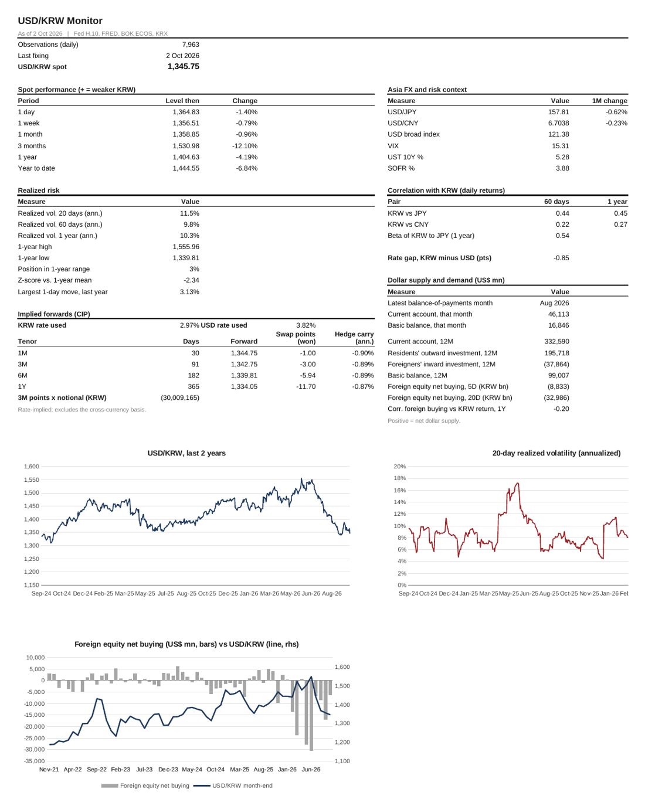
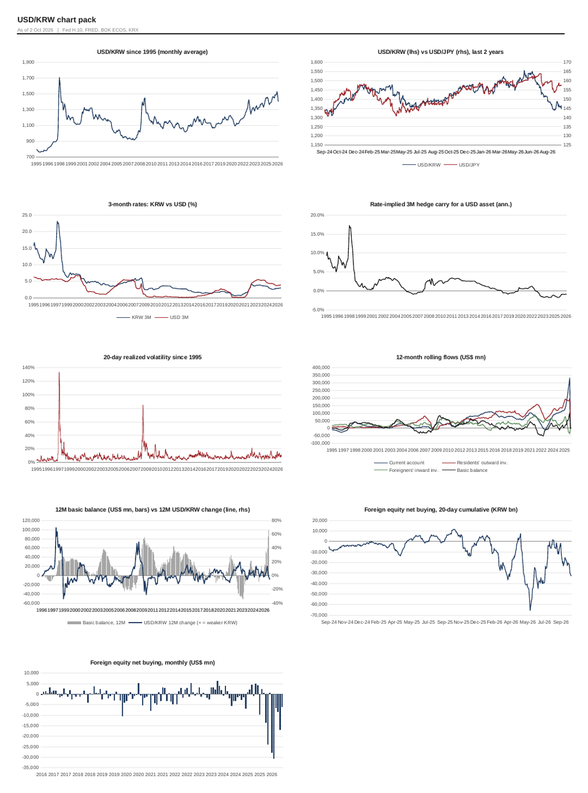
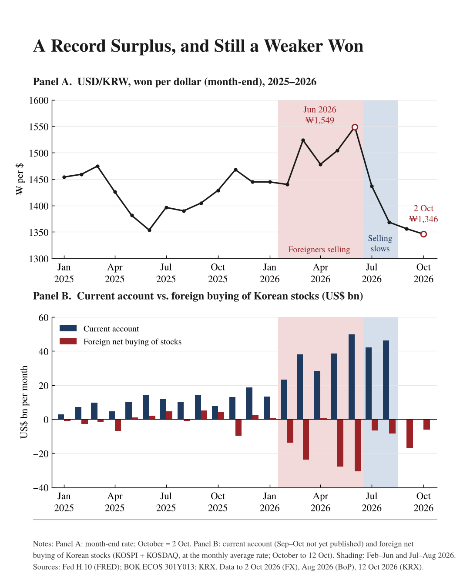

# KRW FX Monitor

A Python tool that builds a USD/KRW monitor in Excel from free public data: Fed H.10 and FRED, Bank of Korea ECOS and KRX. Every number in the workbook is a live Excel formula, so you can change an input (rates, notional, tenors) and the workbook recalculates.

I built it to answer one question: **what actually moves the Korean won?**



## What it does

| Sheet | Contents |
|---|---|
| Dashboard | Spot and changes (1D to YTD); realized volatility (20D, 60D, 1Y); 1-year range and z-score; covered-interest-parity forwards and swap points (1M to 1Y); correlation and beta to JPY and CNY; dollar supply and demand; charts |
| Charts | USD/KRW since 1995, KRW vs JPY, KRW and USD 3M rates, hedge carry, volatility history, 12M rolling balance-of-payments flows, basic balance vs the won, foreign equity flows |
| Inputs | Rate overrides (e.g. CD91 or term SOFR), hedge notional, tenors, lookbacks |
| Daily | USD/KRW, USD/JPY, USD/CNY since 1995, with the broad dollar index, VIX, UST 10Y, SOFR, BOK series and foreign net buying |
| Rates_Monthly | KRW and USD 3M rates, the gap, implied 3M swap points, hedge carry |
| Macro_Annual | GDP growth, inflation and current-account gaps vs the yearly USD/KRW change, with R² |
| Flows_Monthly | Current account, direct and portfolio investment in both directions, basic balance, foreign equity flows; one-variable regressions of USD/KRW on each |
| Flows_Daily | Daily foreign net buying, KOSPI and KOSDAQ |
| Stress | The 15 largest daily won sell-offs and rallies |
| Methodology | The source each series came from, conventions, caveats |



## Quick start

```bash
pip install -r requirements.txt
python krw_fx_monitor.py              # live data, falls back to the bundled snapshot
python krw_fx_monitor.py --offline    # bundled snapshot only
```

Optional free keys add more data. Set them as environment variables (see `.env.example`):

| Variable | Adds | Where to get it |
|---|---|---|
| `FRED_API_KEY` | Broad dollar index, VIX, UST 10Y, SOFR, live 3M rates | fred.stlouisfed.org, then My Account, then API Keys |
| `ECOS_API_KEY` | Bank of Korea balance of payments, BOK USD/KRW, CD91 | ecos.bok.or.kr, then Open API |
| `KRX_ID`, `KRX_PW` | Daily foreign net buying of Korean stocks (via pykrx) | Free account at data.krx.co.kr |

Without keys, the program still builds the full FX, rates and macro workbook from FRED (where reachable), the GitHub mirror of Fed H.10 and the bundled snapshot. Downloaded flow data are cached locally in `data/cache_*.csv`. These cache files are git-ignored and not redistributed.

Other options: `--out file.xlsx`, `--start 2005-01-01`, `--krx-csv file.csv` (a manual KRX export with the columns `date,kospi,kosdaq` in KRW bn), and `--ecos-list 301Y013` (lists the ECOS items in a table).

## What the data say (as of October 2026)



1. **Interest-rate differentials explain almost none of USD/KRW.** The monthly change in the KRW–USD 3M rate gap explains 4.1% of monthly moves over 1995–2026, 0.5% excluding 1997–98, and 0.2% since 2010.
2. **The global dollar is the largest daily driver.** The Fed broad dollar index alone explains 27% of daily USD/KRW variance since 2006, and 39% over the last 12 months. Adding the yen, the yuan, VIX and foreign equity flows adds only about 2 points.
3. **Of the flows, foreign equity flows are the most consistent.** The daily correlation between foreign net buying and USD/KRW was negative in each of the 22 years from 2005 to 2026. Since 2010, the 12-month basic balance explains 13% of the 12-month USD/KRW change. The current account alone explains almost none of it.
4. **2026:** the current account was a record (+$178bn in February–June), yet the won weakened 7% while foreigners sold about $96bn of Korean stocks. When selling slowed in July–August, the won strengthened 12%.
5. **Most of the variation is unexplained by public data.** The largest flows are not published: pension and insurer hedging, exporter forwards, offshore NDFs, client order flow, and real-time BOK intervention.

These are contemporaneous associations, not causal estimates.

## Method notes

- Spot is the Fed H.10 noon New York buying rate, not the Seoul 15:30 close.
- Forwards come from covered interest parity (KRW ACT/365, USD ACT/360). Market swap points also reflect the cross-currency basis.
- Balance-of-payments items are matched by name in ECOS table 301Y013 (BPM6). The program prints the matched names. To pin codes, use `flows_config.json`, for example `{"ca": ["301Y013", "000000"]}`.
- Realized volatility is the standard deviation of daily log returns, annualized with 252 days.
- Every output cell is an Excel formula; Python only writes raw data and layout.

## Data sources

- Board of Governors of the Federal Reserve System, H.10, via FRED (St. Louis Fed) and the `datasets/exchange-rates` GitHub mirror
- OECD Main Economic Indicators (3-month interbank rates) via FRED
- World Bank, World Development Indicators
- Bank of Korea, Economic Statistics System (ECOS)
- Korea Exchange (KRX) Data Marketplace, via [pykrx](https://github.com/sharebook-kr/pykrx)

Check each provider's terms before redistributing its data.

## Disclaimer

For research and education only. This is not investment advice.

## License

MIT. See [LICENSE](LICENSE).
